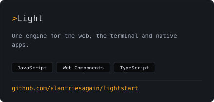
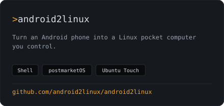
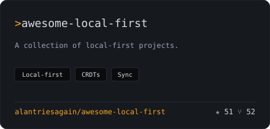
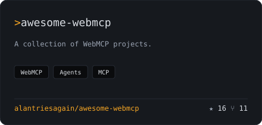
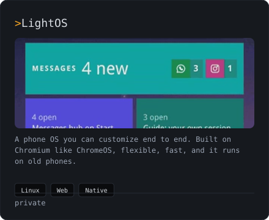
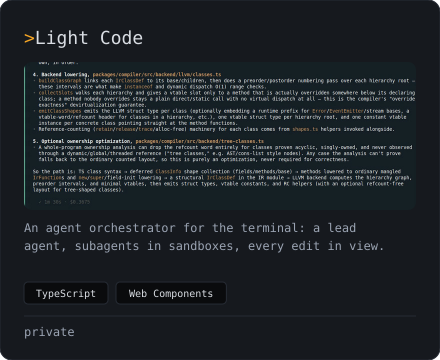
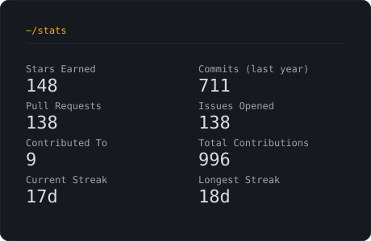
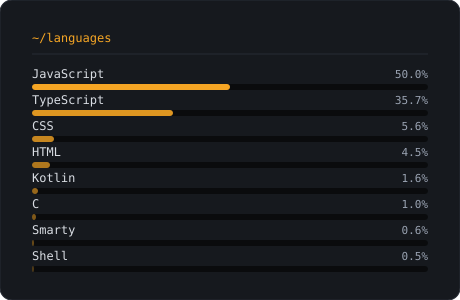

  

## Building

<table>
<tr>
<td width="50%" align="center" valign="top"></td>
<td width="50%" align="center" valign="top"></td>
</tr>
<tr>
<td width="50%" align="center" valign="top"></td>
<td width="50%" align="center" valign="top"></td>
</tr>
<tr>
<td width="50%" align="center" valign="top"></td>
<td width="50%" align="center" valign="top"></td>
</tr>
</table>

## GitHub

<table>
<tr>
<td width="50%"></td>
<td width="50%"></td>
</tr>
</table>

<a href="https://alantriesagain.com">alantriesagain.com</a> · <a href="https://x.com/alantriesagain">x.com/alantriesagain</a> · <a href="https://threads.com/@alantriesagain">threads.com/@alantriesagain</a>

